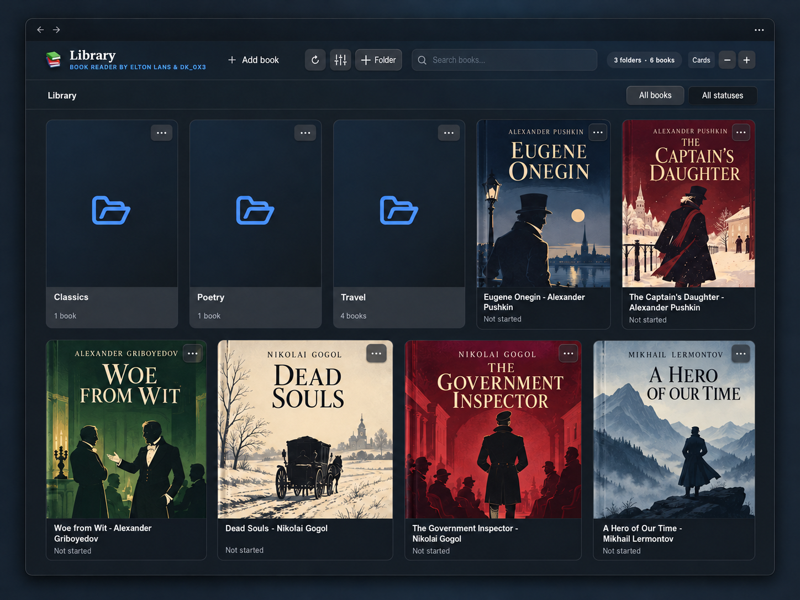
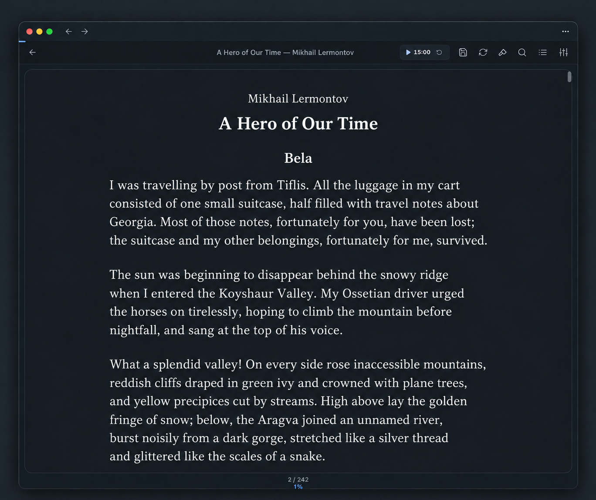
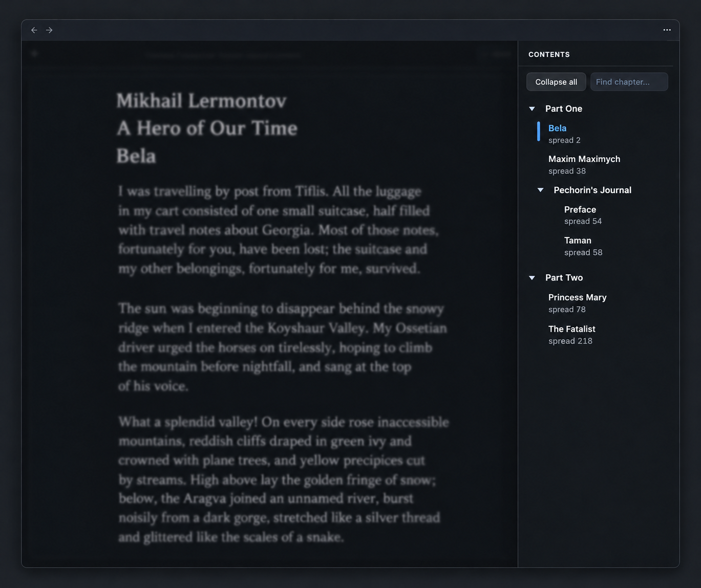
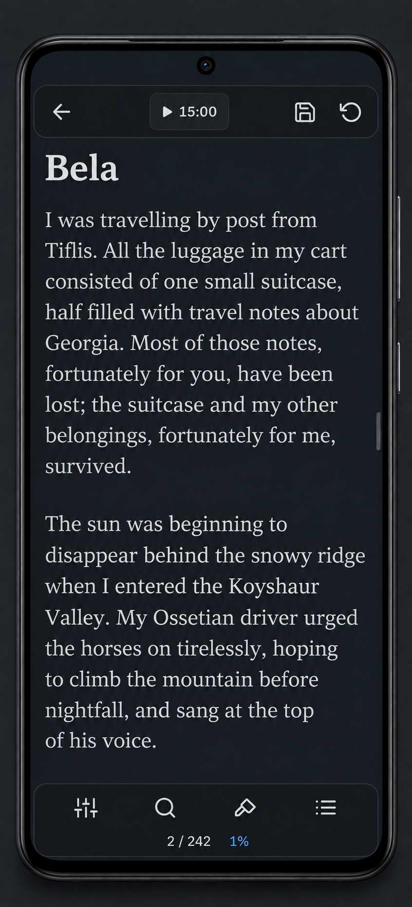
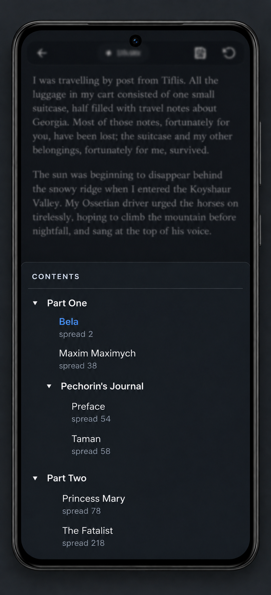
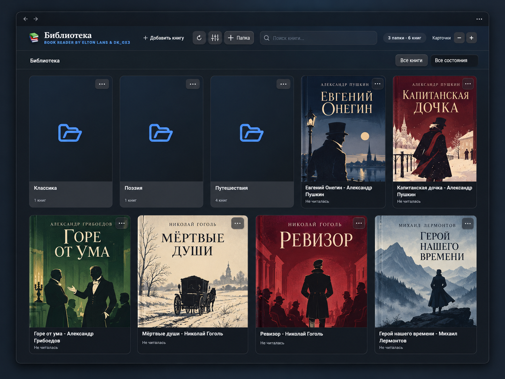
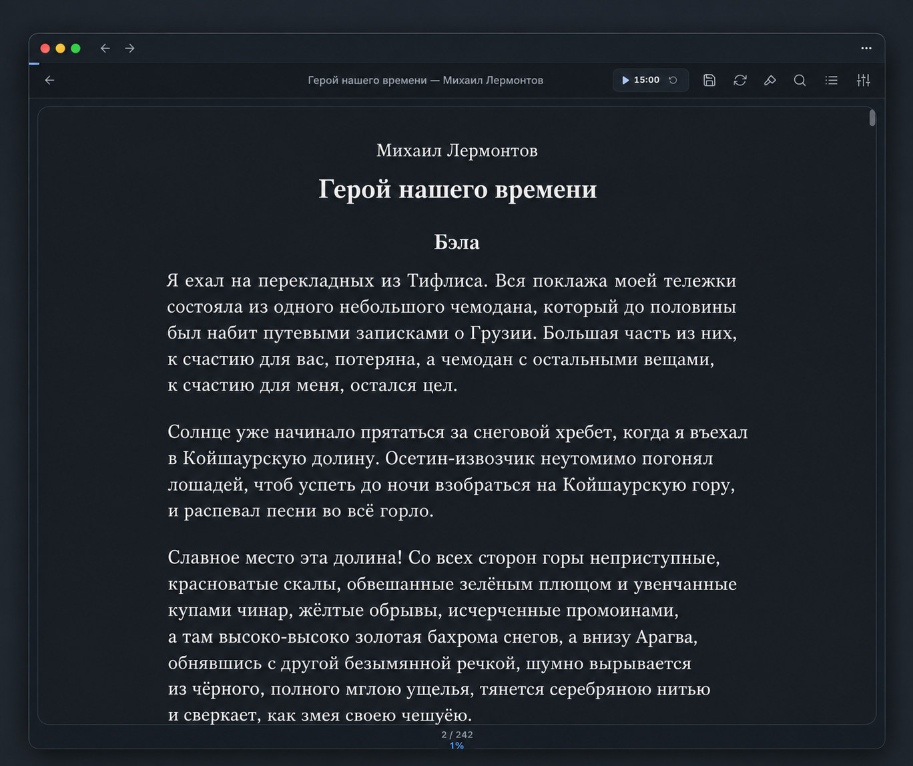
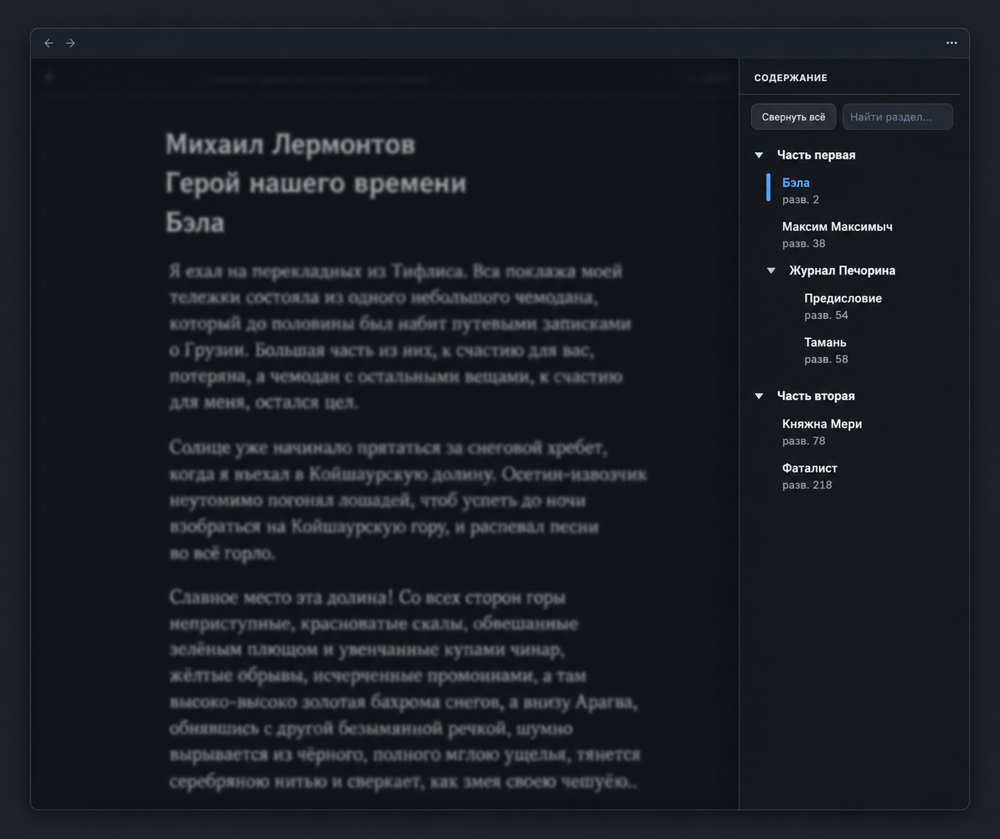
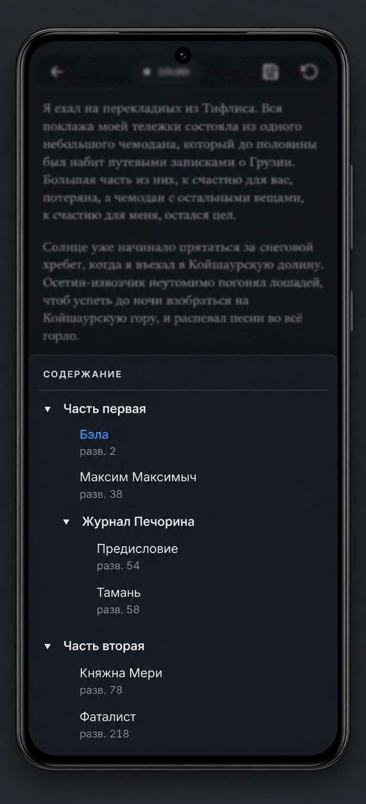

# Curd Reader

[English](#english) · [Русский](#russian) · [Download](https://github.com/DK-0x3/curd-reader/releases/latest) · [Changelog](CHANGELOG.md)

<a id="english"></a>

## English

Read **EPUB, FB2 and PDF** books inside Obsidian. Organise your library, read on desktop or phone, and turn highlights into connected notes.

**Version 1.0.1 · Obsidian 1.11.4+ · Desktop & mobile · MIT**

Maintained by **DK-0x3**. An independent fork of [Book Reader by Elton Labs](https://github.com/swayinfo/elton-reader), based on upstream 3.1.2. This is not an official Elton Labs release.



### A library that stays organised

- Find books across your vault, with covers, progress, search, status filters and a refresh button.
- Organise them in virtual folders up to **five levels** deep, without moving physical files.
- Adjust gallery card size separately for mobile and desktop.

### Read your way

- Paged or scrolling reading, typography controls, themes and an optional reading timer.
- Searchable hierarchical contents with active-section highlighting and automatic parent expansion.
- Highlights, comments, book notes, exports and links back to the exact passage or PDF page.
- Restore history with timestamps and excerpts; delete individual points or clear history while keeping your current position.

<table>
<tr><th>Desktop reading</th><th>Hierarchical contents</th></tr>
<tr><td width="50%"></td><td width="50%"></td></tr>
</table>

### On your phone

<table>
<tr><th>Reading controls</th><th>Distraction-free reading</th><th>Mobile contents</th></tr>
<tr><td width="33%"></td><td width="33%"></td><td width="33%"></td></tr>
</table>

On mobile, a short center tap shows or hides the floating controls. In tap navigation mode, the left/right edges move backward/forward. Text margins are adjustable. Phone, tablet and desktop keep separate preferences, timers and reading logs; existing settings migrate into those profiles on upgrade.

The new previews are edited illustrations based on application screenshots, using classic books as sample content.

<details>
<summary>More feature illustrations — earlier Book Reader interface</summary>

These earlier illustrations show the features inherited from Book Reader; some interface details differ in Curd Reader.


<table>
<tr><th>Library</th><th>Two-column reading</th></tr>
<tr><td width="50%"></td><td width="50%"></td></tr>
<tr><th>Highlights and notes</th><th>Passage analysis</th></tr>
<tr><td width="50%"></td><td width="50%"></td></tr>
<tr><th>Across devices</th><th>Reading themes</th></tr>
<tr><td width="50%"></td><td width="50%"></td></tr>
</table>

</details>

### Install or update

Curd Reader is **not yet in the Obsidian Community directory**. Submission is deferred pending [Obsidian's fork requirements](https://docs.obsidian.md/community-directory/developer-policies).

**With BRAT:** add `DK-0x3/curd-reader`, then enable Curd Reader.

**Manually:** download `main.js`, `manifest.json` and `styles.css` from the [latest release](https://github.com/DK-0x3/curd-reader/releases/latest), put them in `<vault>/.obsidian/plugins/curd-reader/`, reload Obsidian and enable the plugin. When updating, keep your existing `data.json` and reading-data folder. PDF resources are embedded; no separate asset directory is needed.

### Migrate from Book Reader

1. Back up your vault and disable Book Reader before enabling Curd Reader. Both readers handle EPUB/FB2 and share reading-data formats.
2. To retain local settings/history, copy Book Reader's `data.json` into the Curd Reader directory before first enabling it. Do not overwrite newer Curd Reader data.
3. Keep the same reading-data folder. Installation does not reset progress, highlights or virtual folders.
4. Old manual categories migrate once into virtual root folders, retaining legacy multiple memberships.

New note links use `obsidian://curd-reader`. Old `elton-reader` links are handled when the original plugin is disabled. Existing export markers are retained. SecretStorage migration can read the old key; new saves use Curd Reader's namespace.

### Data and privacy

Progress, highlights and folders are readable JSON in the configured reading-data folder, otherwise the import folder, otherwise the vault root. They follow your vault sync. Preferences, book-note links, restore history and caches are stored in the plugin's `data.json`.

API keys use Obsidian SecretStorage and are omitted from new JSON/backups; old backups are not rewritten. No telemetry is added. Reading works offline unless you enable an optional network feature:

| Feature | Destination and data | Default |
| --- | --- | --- |
| Translation | Google Translate: selected passage and language settings | Off |
| Passage analysis | Configured Elton AI, OpenRouter, OpenAI or custom/local endpoint: selected text, book context and prompt | Off |
| Remote covers | Configured cover URL; its server receives the image request | Off |

Providers may require accounts, keys or payment. Local Ollama/LM Studio endpoints can keep analysis on your machine. Passage analysis does not send the whole book.

### Development and known limitations

```sh
npm ci
npm test
npm run lint
npm run build
npm run release:prepare
```

Release preparation creates installable files, a ZIP and checksums in `dist/1.0.1/`. See [development notes](docs/DEVELOPMENT.md).

**63 automated tests pass.** ESLint reports 0 errors and 22 existing warnings. Tests cover real EPUB/PDF extraction, embedded resources, navigation, persistence, device profiles, gestures, folders, contents and history.

Live verification across devices, popout windows and external sync remains necessary. The reported blank first opening of one large EPUB on Android still needs device confirmation after the layout workaround. Full-book DOM virtualisation is not implemented; external sync is not transactional.

### Contributors, licence and support

- **Elton Labs** — original Book Reader project, the foundation of this fork.
- **DK-0x3** — Curd Reader development and maintenance.
- **OpenAI Codex** — assistance with development, bug fixes and testing.

[Changelog](CHANGELOG.md) · [Release notes](docs/RELEASE-1.0.1.md) · [Commit description](docs/COMMIT-1.0.1.md) · [Work log](docs/WORKLOG.md) · [Report an issue](https://github.com/DK-0x3/curd-reader/issues)

[MIT licence](LICENSE) with Elton Labs' original copyright preserved. [Third-party notices](NOTICE.md) and verbatim dependency licences are included in `licenses/` and the generated bundle. Curd Reader 1.0.0 was the first independent release; 1.0.1 adds mobile improvements. Earlier local versions 3.1.3–3.1.7 were development iterations.

[Перейти к русской версии ↓](#russian)

---

<a id="russian"></a>

## Русский

Читайте книги **EPUB, FB2 и PDF** прямо в Obsidian. Организуйте библиотеку, читайте на компьютере и телефоне, превращайте выделения в связанные заметки.

**Версия 1.0.1 · Obsidian 1.11.4+ · ПК и мобильные устройства · MIT**

Разработка и сопровождение — **DK-0x3**. Независимый форк [Book Reader от Elton Labs](https://github.com/swayinfo/elton-reader) на основе версии 3.1.2. Это самостоятельный проект, а не официальный релиз Elton Labs.



### Порядок в библиотеке

- Книги собираются со всего хранилища: обложки, прогресс, поиск, фильтры состояния и кнопка обновления.
- Виртуальные папки с вложенностью до **пяти уровней**, без перемещения физических файлов.
- Размер карточек на телефоне и компьютере настраивается отдельно.

### Чтение под себя

- Страничный режим или прокрутка, настройка шрифтов, темы и необязательный таймер чтения.
- Иерархическое оглавление с поиском, подсветкой текущего раздела и раскрытием его родителей.
- Выделения, комментарии, заметки о книгах, экспорт и ссылки на точный фрагмент или страницу PDF.
- История позиций с датами и отрывками: удаление отдельных записей и очистка с сохранением текущего положения.

<table>
<tr><th>Чтение на ПК</th><th>Иерархическое оглавление</th></tr>
<tr><td width="50%"></td><td width="50%"></td></tr>
</table>

### На телефоне

<table>
<tr><th>Панели чтения</th><th>Чтение без панелей</th><th>Оглавление на телефоне</th></tr>
<tr><td width="33%"></td><td width="33%"></td><td width="33%"></td></tr>
</table>

На телефоне короткое касание центра экрана показывает или скрывает плавающие панели. В режиме листания по клику левый и правый края переключают страницы назад и вперёд. Боковые отступы текста регулируются. Телефон, планшет и ПК сохраняют отдельные настройки, таймеры и журналы чтения; при обновлении прежние настройки переносятся в профили.

Новые превью оформлены на основе скриншотов приложения; для примеров использованы классические произведения.

<details>
<summary>Дополнительные иллюстрации — прежний интерфейс Book Reader</summary>

Эти прежние иллюстрации показывают возможности, унаследованные от Book Reader; отдельные детали интерфейса Curd Reader отличаются.


<table>
<tr><th>Библиотека</th><th>Двухколоночное чтение</th></tr>
<tr><td width="50%"></td><td width="50%"></td></tr>
<tr><th>Выделения и заметки</th><th>Анализ фрагментов</th></tr>
<tr><td width="50%"></td><td width="50%"></td></tr>
<tr><th>Между устройствами</th><th>Темы чтения</th></tr>
<tr><td width="50%"></td><td width="50%"></td></tr>
</table>

</details>

### Установка и обновление

Curd Reader **пока не опубликован в каталоге Community Plugins**. Заявка отложена до выполнения [требований Obsidian к форкам](https://docs.obsidian.md/community-directory/developer-policies).

**Через BRAT:** добавьте `DK-0x3/curd-reader`, затем включите Curd Reader.

**Вручную:** скачайте `main.js`, `manifest.json` и `styles.css` из [последнего релиза](https://github.com/DK-0x3/curd-reader/releases/latest), поместите в `<vault>/.obsidian/plugins/curd-reader/`, перезагрузите Obsidian и включите плагин. При обновлении сохраняйте свой `data.json` и папку данных чтения. Ресурсы PDF встроены, отдельная папка для них не нужна.

### Переход с Book Reader

1. Создайте резервную копию хранилища и отключите Book Reader перед включением Curd Reader. Оба плагина обрабатывают EPUB/FB2 и используют совместимые форматы данных чтения.
2. Чтобы сохранить локальные настройки и историю, скопируйте `data.json` исходного плагина в папку Curd Reader до первого включения. Не заменяйте более новые данные Curd Reader.
3. Сохраните прежнюю папку данных чтения. Установка не сбрасывает прогресс, выделения и виртуальные папки.
4. Старые ручные категории однократно переносятся в папки верхнего уровня с сохранением прежних привязок к нескольким категориям.

Новые ссылки используют `obsidian://curd-reader`. Ссылки `elton-reader` обрабатываются, когда исходный плагин отключён. Прежние маркеры экспорта сохраняются. Миграция SecretStorage может прочитать старый ключ; новые сохранения используют пространство Curd Reader.

### Данные и приватность

Прогресс, выделения и папки хранятся в читаемых JSON: в настроенной папке данных чтения, иначе в папке импорта, иначе в корне хранилища. Они синхронизируются вместе с vault. Настройки, связи с заметками, история позиций и кэш находятся в `data.json` плагина.

API-ключи хранятся через Obsidian SecretStorage и не включаются в новые JSON и резервные копии; прежние копии не переписываются. Телеметрия не добавлена. Чтение работает офлайн, пока вы не включите сетевую функцию:

| Функция | Куда и что отправляется | По умолчанию |
| --- | --- | --- |
| Перевод | Google Translate: выделенный текст и настройки языка | Выключено |
| Анализ фрагмента | Настроенный Elton AI, OpenRouter, OpenAI или собственный/локальный endpoint: выделенный текст, контекст книги и запрос | Выключено |
| Внешние обложки | Указанный URL обложки; сервер получает запрос изображения | Выключено |

Провайдеры могут требовать учётную запись, ключ или оплату. Локальные Ollama/LM Studio позволяют выполнять анализ на вашем компьютере. Книга целиком для анализа фрагмента не отправляется.

### Разработка и ограничения

```sh
npm ci
npm test
npm run lint
npm run build
npm run release:prepare
```

Подготовка релиза создаёт установочные файлы, ZIP и контрольные суммы в `dist/1.0.1/`. Подробнее — [DEVELOPMENT.md](docs/DEVELOPMENT.md).

**63 автоматических теста проходят.** ESLint: 0 ошибок и 22 прежних предупреждения. Проверяются извлечение настоящих EPUB/PDF, встроенные ресурсы, навигация, сохранение данных, профили устройств, жесты, папки, оглавление и история.

Необходима живая проверка разных устройств, отдельных окон и внешней синхронизации. Пустой экран при первом открытии одного большого EPUB на Android ещё требует проверки на устройстве после добавленного обходного решения. Полная виртуализация DOM книги не реализована; внешняя синхронизация не является транзакционной.

### Участники, лицензия и поддержка

- **Elton Labs** — исходный Book Reader, основа этого форка.
- **DK-0x3** — разработка и сопровождение Curd Reader.
- **OpenAI Codex** — помощь в разработке, исправлении ошибок и тестировании.

[Изменения](CHANGELOG.md) · [Описание релиза](docs/RELEASE-1.0.1.md) · [Описание коммита](docs/COMMIT-1.0.1.md) · [Контекст работы](docs/WORKLOG.md) · [Сообщить о проблеме](https://github.com/DK-0x3/curd-reader/issues)

[Лицензия MIT](LICENSE), исходное уведомление об авторстве Elton Labs сохранено. [Уведомления о зависимостях](NOTICE.md) и тексты их лицензий находятся в `licenses/` и сборке. Curd Reader 1.0.0 — первый независимый релиз; 1.0.1 добавляет мобильные доработки. Прежние локальные версии 3.1.3–3.1.7 были промежуточными сборками.

[Back to English ↑](#english)
